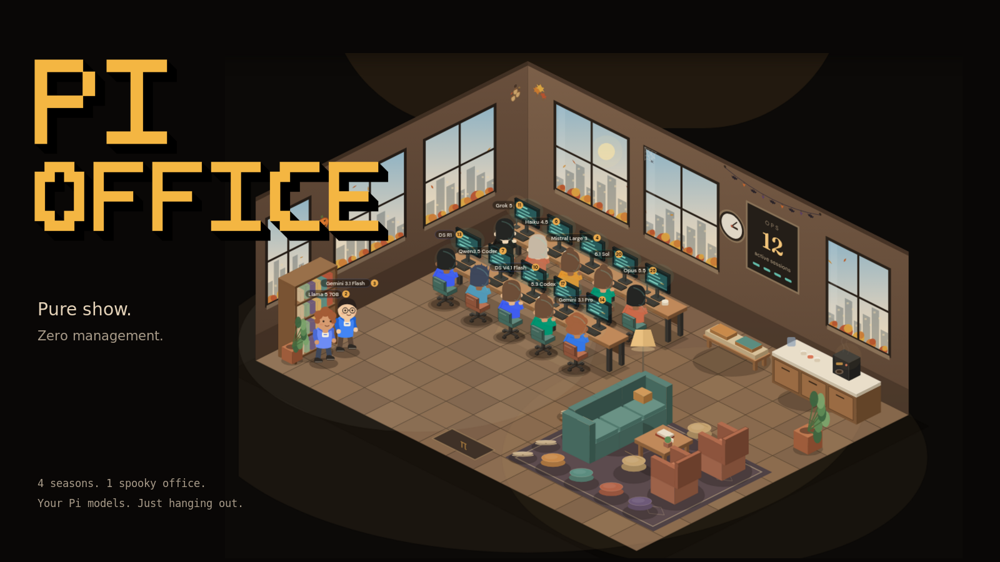

# Pi Office



**Yet another useless virtual office. This time, it's pure show.**

Using [Pi](https://pi.dev)? Install this in the same environment and give your models somewhere to look busy.
Watch them clock in, grab a hot desk, and type away while you get on with your actual work. When they're done,
it's back to the lounge for coffee. Day shift, night shift, questionable work–life balance. The usual.

No task management. No agent orchestration. No buttons pretending to make anyone more productive.
Just a little isometric office, doing its thing.

### What you get for absolutely no good reason

- **A tiny cast of coworkers.** Your Pi models become chibi characters, each with their own look.
- **Actual activity, decorative consequences.** Working models walk to desks and type; idle ones take a break.
- **Day and night.** The sky follows your local clock. The monitors keep glowing after dark.
- **Stats to poke at.** Tap a character for tokens, tool calls, levels and lifetime numbers. That's it. No controls.
- **A strictly read-only view.** No Pi hooks or extensions, no writes to Pi, and no prompts or responses sent to
  the browser. Public activity metadata still deserves a [privacy check](SECURITY.md).

## Four seasons. One festive guest.

Because apparently a virtual office needs weather, too.

| Winter | Spring | Summer | Autumn |
| --- | --- | --- | --- |
| Snow outside, warm lights inside | Blossoms and drifting petals | Sunny skies and evening fireflies | Turning trees and falling leaves |

All four are ready out of the box and follow your local calendar. The windows, light and wall details change
with them. Want winter in July? There's a [preview for that](#develop).

**And yes, Halloween is on duty.** Our one festive overlay brings a paper garland, a little jack-o'-lantern,
a cobweb and a bat. It clocks in **October 17–November 7** each year, on top of whichever season you're in.
Four seasons, plus one spooky guest—not a fifth season. You can preview it any time.

> Install it next to Pi. Leave a tab open. Watch the little coworkers work night and day.
>
> Does it help? Debatable. Does it have seasons? Absolutely.

*Hero artwork uses the actual app scene with demo activity, not private session data.*

## Install and run

Requirements: Node >= 24.12 (`node --version`) and Pi having written at least one session on this machine. No
admin rights are needed and nothing is installed into Pi: the office only reads Pi's data files, so it does not
matter where or how the `pi` binary/npm package is installed.

```sh
git clone https://github.com/anazhd/pi-office.git
cd pi-office
npm ci
npm run build                          # production web app -> dist/
node scripts/setup.mjs doctor          # checks Node, build, data paths, config, service manager
npm start                              # foreground on any OS: http://127.0.0.1:6702
```

Optional per-user background service (re-run after updates; it keeps the existing service settings):

| OS | Command | What it installs |
| --- | --- | --- |
| Linux (systemd) | `node scripts/setup.mjs install-service` or `sh scripts/install-local.sh` (also builds) | `~/.config/systemd/user/pi-office.service`, `systemctl --user enable/restart`. Logs: `journalctl --user -u pi-office`. Survives logout only with `loginctl enable-linger`. |
| macOS | `node scripts/setup.mjs install-service` | `~/Library/LaunchAgents/local.pi-office.plist` (launchd agent, starts at login, restarts on crash). Logs: `~/Library/Logs/pi-office/`. |
| Windows | `node scripts\setup.mjs install-service` | A Startup-folder launcher that opens a minimised "Pi Office" window at logon (restarts on crash; close the window to stop). No Task Scheduler or admin. Logs: `%LOCALAPPDATA%\pi-office\pi-office.log`. |
| Other / no systemd user session (WSL1, containers, BSD) | `npm start` under your own supervisor | Nothing; the doctor and installer say so. |

Add `--dry-run` to print the exact files and commands first, `--env KEY=VALUE` / `--unset KEY` to change a
setting, and `node scripts/setup.mjs uninstall-service` to remove it (desk state and logs are kept). On a **new installation**, server variables in your shell (`HOST`, `PORT`, `PI_OFFICE_*`, `PI_CODING_AGENT_*`,
`XDG_STATE_HOME`) seed the service. On **upgrades**, saved settings win: use `--env` / `--unset` explicitly to
change them, so an unrelated shell variable cannot move your data or port. Path values must be absolute (or `~/…`). CI is configured to check Linux, macOS and Windows and render all three service plans. Local validation so far
has run on Linux; macOS/Windows service execution still needs real-machine verification. Check the service log
after the first login.

### Where data comes from

Read-only, first match wins (the same rules Pi uses, including `~` and Windows path forms):

1. `PI_OFFICE_SESSIONS_DIR`
2. `PI_CODING_AGENT_SESSION_DIR`
3. `sessionDir` in Pi's global `settings.json` (absolute paths only)
4. `PI_CODING_AGENT_DIR/sessions`
5. `~/.pi/agent/sessions` (`%USERPROFILE%\.pi\agent\sessions` on Windows)

Model display names come from `models-store.json` / `models.json` in `PI_CODING_AGENT_DIR` (default
`~/.pi/agent`). If you start Pi with `--session-dir` or a project-local `.pi/settings.json` session dir, the office
cannot see that choice: set `PI_OFFICE_SESSIONS_DIR` to it. A background service does not read your shell profile,
so set any of these in the service (the installer copies them on first install; on upgrades use `--env KEY=VALUE`).

For example, point to a custom sessions directory before running the doctor or installer:

```sh
# Linux/macOS (bash/zsh)
export PI_OFFICE_SESSIONS_DIR="$HOME/custom-pi/sessions"
```

```powershell
# Windows PowerShell
$env:PI_OFFICE_SESSIONS_DIR = "$HOME\\custom-pi\\sessions"
```

```bat
rem Windows Command Prompt
set "PI_OFFICE_SESSIONS_DIR=%USERPROFILE%\\custom-pi\\sessions"
```

The inline `NAME=value command` development examples below use POSIX shell syntax. In PowerShell use
`$env:NAME = 'value'` first; in Command Prompt use `set "NAME=value"`. Production `npm run build` deliberately
ignores all preview/API overrides and `.env` files, on every OS.

### Exposing it beyond this machine

Out of the box the server binds `127.0.0.1` and only answers `localhost`/`127.0.0.1` Host names. There is no
login: publishing the office publishes model names, project basenames, tool names, token counts and activity times.
Read [SECURITY.md](SECURITY.md) for the reverse-proxy/tunnel setup (`PI_OFFICE_ALLOWED_HOSTS`,
`PI_OFFICE_TRUSTED_PROXIES`) and the privacy checklist. **Existing public deployments must add their hostname to
`PI_OFFICE_ALLOWED_HOSTS` before restarting on this version**, or the proxy gets `421`.

## Develop

```sh
npm ci
npm run dev                 # Expo web on :8081
```

The dev server talks to `EXPO_PUBLIC_OFFICE_API` (e.g. `http://127.0.0.1:6702`; loopback dev origins are allowed
by the server's CORS policy) or, more simply, to the fixture:

```sh
EXPO_PUBLIC_OFFICE_MOCK=1 npm run dev
npm run build:mock          # fixture build for demos only; never deploy it (the installer refuses)
```

The fixture (`src/api/mock.ts`) cycles through four office states every few seconds: quiet lounge, a few models at
work, a busier floor with tool calls, and a second shift. That makes walking, typing, coffee sips and speech
bubbles observable without touching Pi.

The office also has four seasons (see **The scene** below). To preview one out of turn:

```sh
# any already-running web server, e.g. the service on :6702 or a dev server on :8081
open 'http://127.0.0.1:8081/?season=winter'     # winter | spring | summer | autumn (fall also works)
# or for a dev run / build
EXPO_PUBLIC_OFFICE_SEASON=autumn EXPO_PUBLIC_OFFICE_MOCK=1 npm run dev
```

A valid `?season=` wins; otherwise a valid `EXPO_PUBLIC_OFFICE_SEASON`; otherwise the calendar. Invalid values are
ignored, so a typo never blanks the decorations.

The one dated festive overlay, Halloween, previews the same way and is independent of the season (
`?festive=auto` follows the calendar and beats the env var):

```sh
open 'http://127.0.0.1:8081/?festive=halloween'          # halloween | none | auto
open 'http://127.0.0.1:8081/?season=winter&festive=halloween'
EXPO_PUBLIC_OFFICE_FESTIVE=none EXPO_PUBLIC_OFFICE_MOCK=1 npm run dev
```

For a native build pointed at another host:

```sh
EXPO_PUBLIC_OFFICE_API=https://office.example.com npx expo start
```

## Build, check, deploy

```sh
npm run typecheck     # tsc --noEmit over app/, src/, shared/ and server/
npm run test:server   # node --test server/tests/*.test.ts
npm run test:scene    # node --test src/scene/tests/*.test.ts
npm run test:scripts  # build wrapper, dependency and setup-CLI tests
npm run build         # production expo export -p web -> dist/ (dev/preview env overrides removed)
npm run check         # all of the above
```

Deploy an update: `npm run build`, then restart the service (`node scripts/setup.mjs install-service` does both the
rewrite and the restart; on Linux `sh scripts/install-local.sh` also builds). CI runs the checks on Linux, macOS
and Windows (`.github/workflows/ci.yml`). See [CONTRIBUTING.md](CONTRIBUTING.md).

## Under the hood

- Expo SDK 58 (`expo@~58.0.16`), Expo Router, TypeScript
- NativeWind 4 + Tailwind CSS 3.4 for HUD/card chrome
- `react-native-svg` for the office, furniture and character sprites (web, iOS and Android)
- A shared `useTick(20)` clock drives SVG transforms and pauses when the document/app is hidden
- Live data: `GET /api/office` + SSE `GET /api/stream`, with reconnect backoff and polling fallback on native
- A single-page web export served from `dist/`
- Zero-dependency Node >= 24.12 server, running TypeScript directly on Linux, macOS and Windows

## Layout

```
app/                        Expo Router routes (thin: layout loads fonts, index renders the screen)
src/api/                    fetch client, EventSource + polling hook inputs, mock fixture, shared type re-export
src/hooks/                  useOffice() (live snapshot + connection state), useTick() (paused when hidden)
src/scene/                  iso math, room layout/seats, furniture, chibi sprites, speech bubbles, scene model
src/components/             HUD top bar, roster strip, character card, activity ticker, screen composition
shared/office-types.ts      API contract (types only, shared with server/)
server/                     read-only data server: index (HTTP), config (Host/Origin/proxy policy), paths (data/state
                            locations), sessions/parse/office (log tailing → snapshot), desks, sse
scripts/                    build wrapper, setup CLI (doctor + per-user service for Linux/macOS/Windows), smoke test
```

## The scene

- 2:1 isometric projection, `TILE_W=64`, `TILE_H=32`, floor 14×10 tiles, fixed `viewBox` fitted to the window.
- Painter's algorithm: furniture, characters and chair backs are sorted by `gx + gy` (then depth) so overlaps
  read correctly.
- Two 5-seat bench desks (10 hot desks), lounge for 16 (sofa, armchairs, window bench, ottomans, beanbags,
  cushions), coffee counter, bookshelf, plants, floor lamp, rug, entrance mat.
- Back walls with six windows. The sky tint follows the viewer's local time (day / golden hour / night with moon
  and stars), and warm interior light pools keep the night scene readable.
- Seasons follow the viewer's local calendar (meteorological seasons, northern hemisphere: Dec–Feb winter,
  Mar–May spring, Jun–Aug summer, Sep–Nov autumn; add a hemisphere line in `seasonForDate` if you ever need one).
  Each season shifts the daytime sky, the window light pool and a whisper of floor tint, puts weather outside the
  glass (snow, petals, drifting motes or fireflies, leaves), dresses the skyline (bare, blossom, full or turning
  trees; roof snow in winter) and hangs one small piece on each wall — a pine sprig, planter, straw hat or autumn
  leaves. Particles ride the existing tick (≤64 across all six windows) and freeze under the OS "reduce motion"
  setting.
- One dated overlay, Halloween (viewer's local Oct 17 – Nov 7 inclusive, every year): a paper garland, a felt
  jack-o'-lantern that lights up at dusk and night, a window cobweb and a bat at the moon. It is static wall art
  layered on top of whatever season it is and never changes the season (`src/scene/festive.ts`,
  `festive-layers.tsx`). No other holidays, no particles, nothing on the floor.
- Character look is deterministic from the model id: provider shirt colour, hair style/colour, skin, accessories.
  Provider colours follow the spec: Anthropic clay, OpenAI teal, DeepSeek blue, Google blue, xAI near-black.
- Idle: seated, mug in hand, breathing bob, steam, occasional sip, magazine or phone for variety.
- Working: walks the aisle route in ~1–3 s, sits facing the monitor, types, monitor glows with scrolling code,
  speech bubble shows `thinking` dots or the tool icon/name, plus the project basename and a `×N` badge.
- New models walk in from the entrance mat with a little confetti burst.
- Desks are server-owned (see **Hot desks** below): a working model gets a random free desk and keeps it. Lounge seats
  are stable by first-seen order.

## Activity inference

Terminal assistant replies (including errors/aborts) end inferred work; trailing tool results cannot revive them.
Failed tool results also stop inferred work until a new user/assistant continuation. Concurrent sessions are
independent: one failure does not stop another active session of the same model. Errors still count in stats.

Logs do not prove process liveness. Unfinished work expires from the last relevant event timestamp, **not file
mtime**: 10 minutes for thinking, 60 minutes for silent tool execution. Unrelated title/custom updates cannot
renew historical work. T3's embedded Pi workers do not provide verified exact-session process liveness via argv;
no lifecycle hooks are installed. A killed run can remain inferred active until expiry; a tool silent beyond an
hour can be falsely idle. See `SPEC.md`. The server keeps the desk for a 20-second grace after the last activity before the character returns to coffee,
including on errors; working badges clear immediately.

Models leave the floor after 24 hours without activity and return when used again. Lifetime stats and token totals are retained.

## Hot desks

- The server is the only authority for desk occupancy (`shared/desk-allocation.ts`, applied in `server/sessions.ts`).
  Each snapshot carries every character's `desk` (0–9 or `null`); clients place characters exactly there and never
  choose a desk themselves.
- A working model without a desk takes one of the free desks **at random**. It keeps that desk while it works and for
  a 20-second grace after going idle. Released desks are free for the next assignment; departures never move anyone
  else.
- Capacity: with all 10 desks taken, extra working models wait on the standing spots until a desk is released.
- Persisted in app-owned state, never under `~/.pi`: `$PI_OFFICE_STATE_FILE`, else
  `$XDG_STATE_HOME/pi-office/desks.json` / `~/.local/state/pi-office/desks.json` on Linux (and on macOS/Windows when
  that file already exists or `XDG_STATE_HOME` is set), else `~/Library/Application Support/pi-office/desks.json`
  (macOS) or `%LOCALAPPDATA%\pi-office\desks.json` (Windows).
  The file is rewritten only when an assignment changes (temp file + rename). A browser refresh, a reconnect and a
  server restart or deploy therefore leave everyone at their desk. A corrupt or unwritable file starts an empty office
  (with one warning) instead of failing.

## Read-only guarantee

- No inputs write anywhere. The only interaction is selecting a character/roster card (read-only stats).
- The only file the server writes is its own desk-occupancy state (above). Nothing under `~/.pi` is ever written.
- The client only consumes `OfficeSnapshot`; the server strips message text, session names, thinking, tool
  arguments and tool output before sending.
- Card contents: display name, provider/model, level/title/XP, lifetime messages, tokens, tool calls, sessions,
  first/last seen, current sessions (project basename + tool name only).
- The API is unauthenticated metadata; what that reveals and how to publish it deliberately is in
  [SECURITY.md](SECURITY.md).

## License

[MIT](LICENSE) — Copyright (c) 2026 Anaz Haidhar ([anazhd.com](https://anazhd.com)).

Free to use, fork, modify and commercialize. Distributed copies or substantial portions must retain the copyright
and license notice. A credit and link back to Pi Office would also be appreciated, but are not required beyond
the MIT notice.
